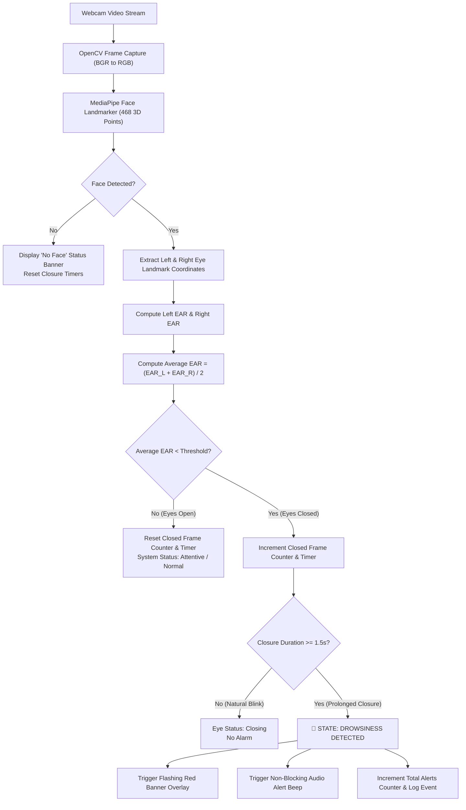

# 🚗 AI-Based Driver Drowsiness Detection System

[](https://www.python.org/)
[](https://developers.google.com/mediapipe)
[](https://opencv.org/)
[](https://streamlit.io/)
[](#)

A real-time, non-invasive **Computer Vision and AI system** that monitors driver alertness via laptop webcam. The system extracts **468 3D facial landmarks** using Google MediaPipe, computes the **Eye Aspect Ratio (EAR)**, filters out natural blinks, detects prolonged eye closure indicative of drowsiness, and triggers instantaneous audio-visual warnings.

---

> [!IMPORTANT]
> ### ⚠️ Academic Prototype & Safety Notice
> This project is developed strictly as an **educational prototype** for a **B.Tech CSE AIML college capstone presentation**.
> - It is **not** a certified automotive safety device.
> - It does **not** claim to diagnose medical fatigue or guarantee accident prevention.
> - **Do not test or operate this application while operating a motor vehicle.**

---

## 📑 Table of Contents
1. [Project Overview](#-project-overview)
2. [How the System Works](#-how-the-system-works)
3. [System Architecture & Dataflow](#-system-architecture--dataflow)
4. [Mathematical Formulation: Eye Aspect Ratio (EAR)](#-mathematical-formulation-eye-aspect-ratio-ear)
5. [Project Structure](#-project-structure)
6. [Prerequisites & Installation](#-prerequisites--installation)
7. [Running the Application](#-running-the-application)
   - [Mode 1: Modern Streamlit Web Dashboard](#mode-1-modern-streamlit-web-dashboard-recommended)
   - [Mode 2: Desktop OpenCV Window](#mode-2-desktop-opencv-window-low-latency)
8. [Automated Testing & Verification](#-automated-testing--verification)
9. [Troubleshooting Guide](#-troubleshooting-guide)
10. [5-Minute College Presentation & Demo Plan](#-5-minute-college-presentation--demo-plan)

---

## 🌟 Project Overview

Driver fatigue and microsleeps are leading causes of road accidents worldwide. Traditional detection methods often rely on expensive specialized sensors (e.g., infrared steering sensors, EEG headsets). 

This project delivers a **cost-free, software-driven, vision-based alternative** using standard RGB webcams:
- **100% Free and Open Source**: Zero paid APIs, no specialized hardware.
- **Deep-Learning Facial Mesh**: Uses Google MediaPipe Face Landmarker for 468 3D landmarks.
- **Geometric EAR Computation**: Calculates Euclidean eye aspect ratio frame-by-frame.
- **Temporal Drowsiness Filter**: Distinguishes normal human blinks ($100-300\text{ ms}$) from prolonged eye closure ($> 1.5\text{ s}$).
- **Multi-Modal Warning System**: High-visibility flashing visual banner and non-blocking audible beep.
- **Interactive Web Dashboard**: Streamlit UI with real-time KPI metrics, live EAR telemetry chart, event history, and customizable sensitivity sliders.

---

## 🔬 How the System Works

The detection pipeline operates in five continuous stages:

1. **Webcam Acquisition**: Captures live RGB video frames at $25-30\text{ FPS}$.
2. **Face Mesh & Landmark Localization**: MediaPipe's neural network detects the driver's face and isolates the specific eyelid landmarks.
3. **EAR Calculation**: Euclidean distances between upper and lower eyelids are calculated and normalized by horizontal eye width.
4. **Temporal State Tracking**:
   - If $\text{EAR} < \text{Threshold}$ (default $0.24$), an eye closure timer and consecutive frame counter increment.
   - If closure persists beyond the threshold (e.g., $\ge 25\text{ frames}$ or $\ge 1.5\text{ seconds}$), state transitions from `NORMAL` to `DROWSY`.
   - When eyes reopen, counters immediately reset to zero.
5. **Alert Actuation**:
   - Red flashing HUD and warning banner displayed.
   - Non-blocking audio alert beep sounded via background daemon thread.

---

## 📐 Mathematical Formulation: Eye Aspect Ratio (EAR)

Originally introduced by Soukupová and Čech (2016), the **Eye Aspect Ratio (EAR)** is a scale-invariant metric reflecting eye openness:

$$\text{EAR} = \frac{\|P_2 - P_6\| + \|P_3 - P_5\|}{2 \cdot \|P_1 - P_4\|}$$

Where:
- $P_1, P_4$: Horizontal eye corner landmark coordinates.
- $P_2, P_6$ and $P_3, P_5$: Upper and lower eyelid vertical landmark coordinate pairs.

```
       P2        P3
        +--------+
       /          \
  P1  +            +  P4   (Horizontal Eye Length)
       \          /
        +--------+
       P6        P5
```

### MediaPipe Landmark Mapping:
| Eye | $P_1$ (Corner) | $P_2$ (Top 1) | $P_3$ (Top 2) | $P_4$ (Corner) | $P_5$ (Bottom 2) | $P_6$ (Bottom 1) |
|---|---|---|---|---|---|---|
| **Left Eye** | Index 33 | Index 160 | Index 158 | Index 133 | Index 153 | Index 144 |
| **Right Eye** | Index 362 | Index 385 | Index 387 | Index 263 | Index 373 | Index 380 |

### Typical Values:
- **Eyes Open**: $\text{EAR} \approx 0.28 - 0.38$
- **Eyes Closed**: $\text{EAR} < 0.20$
- **Detection Threshold**: $\text{EAR} \le 0.24$ (configurable via sidebar slider)

---

## 🏗️ System Architecture & Dataflow



---

## 📁 Project Structure

```
driver_drowsiness_system/
│
├── app.py                     # Streamlit Modern Web Dashboard
├── desktop_app.py             # Desktop OpenCV Real-Time Application
├── drowsiness_detector.py     # Core AI Engine (MediaPipe FaceLandmarker + EAR)
├── audio_alert.py             # Non-blocking audio manager (winsound + wav chime)
├── download_model.py          # Auto-downloads official MediaPipe model file
├── test_detector.py           # Automated unit & integration test suite
├── requirements.txt           # Python dependency definitions
├── README.md                  # Complete documentation and presentation guide
│
├── assets/
│   └── alert.wav              # Synthesized dual-tone warning chime
└── models/
    └── face_landmarker.task   # MediaPipe FaceLandmarker model bundle (~3.7 MB)
```

---

## ⚙️ Prerequisites & Installation

### 1. Requirements
- **OS**: Windows 10/11, macOS, or Linux
- **Python**: Version `3.10`, `3.11`, `3.12`, or `3.13`
- **Hardware**: Any standard laptop webcam or USB webcam

### 2. Setup Instructions

1. **Open your terminal or PowerShell** in the project directory:
   ```powershell
   cd "c:\Users\ttejd\Downloads\hackaton 2"
   ```

2. **Verify Python is available**:
   ```powershell
   py --version
   ```

3. **Install the dependencies**:
   ```powershell
   py -m pip install -r requirements.txt
   ```

4. **Verify the MediaPipe AI model**:
   ```powershell
   py download_model.py
   ```
   *(The script automatically downloads `face_landmarker.task` from Google's CDN if not already present).*

---

## 🚀 Running the Application

### Mode 1: Modern Streamlit Web Dashboard (Recommended)

Run the full web dashboard with real-time telemetry, KPI cards, and parameter tuning:

```powershell
py -m streamlit run app.py
```

- Streamlit will automatically launch in your default web browser at `http://localhost:8501`.
- Click **`▶️ Start`** in the left sidebar to activate live monitoring.
- Click **`⏹️ Stop`** to safely release the webcam and pause monitoring.

#### Features in the Web Dashboard:
- **Live Video Feed**: Annotated with eye contours and warning HUD.
- **KPI Metrics**: Real-time Eye State (Open/Closed), Current EAR, Alert Count, and System Status.
- **Dynamic EAR Graph**: Interactive line plot showing live EAR vs. detection threshold.
- **Alert History Table**: Timestamped log of all drowsiness events during the session.
- **Sensitivity Sliders**: Adjust EAR threshold ($0.15-0.35$), consecutive frame count ($10-60$), and closure time ($0.5-4.0\text{ s}$).

---

### Mode 2: Desktop OpenCV Window (Low-Latency)

For a lightweight, ultra-low latency desktop application:

```powershell
py desktop_app.py
```

#### Keyboard Shortcuts:
| Key | Action |
|---|---|
| `q` | Quit application and release webcam |
| `r` | Reset total alert counters |
| `m` | Toggle audio warning beep (mute/unmute) |
| `+` / `=` | Increase EAR threshold sensitivity (+0.01) |
| `-` | Decrease EAR threshold sensitivity (-0.01) |

---

## 🧪 Automated Testing & Verification

An automated test suite is included to guarantee mathematical and pipeline accuracy before demonstrations:

```powershell
py test_detector.py
```

### Verified Test Cases:
| Test Category | Tested Feature | Status |
|---|---|---|
| **Mathematics** | 2D Euclidean Distance calculation | `PASSED` |
| **Mathematics** | Open Eye EAR calculation ($\text{EAR} \approx 0.40 > 0.25$) | `PASSED` |
| **Mathematics** | Closed Eye EAR calculation ($\text{EAR} \approx 0.05 < 0.20$) | `PASSED` |
| **Edge Cases** | Degenerate/collapsed coordinates (zero division prevention) | `PASSED` |
| **Resilience** | `None` and empty image arrays handled without crashing | `PASSED` |
| **Resilience** | Blank black frame / missing face gracefully reported | `PASSED` |
| **State Machine** | Counter and alert state reset function | `PASSED` |
| **Audio** | Non-blocking audio trigger returns in $< 50\text{ ms}$ | `PASSED` |
| **Audio** | Cooldown timer suppresses rapid audio stutter | `PASSED` |
| **Audio** | Mute flag correctly suppresses audio | `PASSED` |
| **Model** | `face_landmarker.task` file exists and has valid size ($3.7\text{ MB}$) | `PASSED` |

---

## 🛠️ Troubleshooting Guide

### 1. "Could not open webcam at Camera Index 0"
- **Cause**: Another program (Zoom, MS Teams, Discord, or a browser tab) is locking the webcam.
- **Fix**: Close all other apps using the camera.
- **Camera Index**: If you have an external USB camera plugged in, change the camera index in the sidebar from `0` to `1` or `2`.
- **Windows Privacy Settings**: Open **Windows Settings > Privacy & security > Camera**, and verify that **"Let apps access your camera"** and **"Let desktop apps access your camera"** are both **ON**.

### 2. "Detection threshold triggers while eyes are still open"
- **Cause**: Lighting conditions, eye shape, or wearing heavy-rimmed glasses may slightly lower baseline EAR.
- **Fix**: Use the sidebar slider to lower the **EAR Threshold** from `0.24` down to `0.21` or `0.20`.

### 3. "Audio beep does not make sound"
- **Cause**: System volume is muted or Windows hardware beep is disabled.
- **Fix**: Verify system speaker volume is above 20%. The system includes a fallback to play `assets/alert.wav` automatically.

### 4. "No Face Detected" warning appears
- **Cause**: Insufficient room lighting or user is seated too far / angled away from the camera.
- **Fix**: Sit $40-70\text{ cm}$ in front of the laptop screen facing forward in a well-lit room.

---

## 🎤 5-Minute College Presentation & Demo Plan

Use this structured script to present and demonstrate your project to professors and external evaluators:

### Minute 1: Introduction & Problem Statement
> *"Good morning respected evaluators. Today I present our AI-Based Driver Drowsiness Detection System. Driver fatigue accounts for thousands of preventable highway accidents each year. Our objective was to design a non-invasive, software-driven computer vision system using MediaPipe and OpenCV that detects driver drowsiness in real-time without requiring expensive specialized hardware."*

### Minute 2: Technical Architecture & EAR Algorithm
> *"Instead of simple bounding boxes, our system utilizes Google MediaPipe's FaceLandmarker to track 468 3D facial landmarks. We isolate 6 key fiducial landmarks around each eye and compute the Eye Aspect Ratio (EAR), based on the ratio of vertical eyelid distance to horizontal eye length. A normal open eye exhibits an EAR of approximately 0.28 to 0.38, whereas eye closure drops this value below 0.20."*

### Minute 3: Live Demonstration — Step 1: Normal Blinking
- Launch `py -m streamlit run app.py` and click **`▶️ Start`**.
- Look into the webcam with eyes open.
- Point out the green eye contour overlays and the live EAR reading ($\sim 0.30$).
> *"As you can see on the live dashboard, the driver is attentive. When I blink naturally for a fraction of a second, the system recognizes this as a standard blink ($100-300\text{ ms}$) and correctly suppresses any false alarms."*

### Minute 4: Live Demonstration — Step 2: Drowsiness Detection
- Close your eyes and keep them closed for 2 seconds.
- The red flashing warning banner appears, and the audible beep sounds.
- Open your eyes; the system immediately recovers to normal state.
> *"Now, simulating a microsleep, I close my eyes for over 1.5 seconds. Notice that the temporal filter triggers: the EAR line on the telemetry chart plummets below the red threshold line, the prominent red visual warning appears, and an audio buzzer immediately alerts the driver to wake up. As soon as my eyes reopen, the system safely resets."*

### Minute 5: Robustness, Engineering & Conclusion
- Demonstrate turning your head away to show "No Face Detected" handling without crashing.
- Highlight the modular codebase, unit tests (11 passing tests), and zero-cost design.
> *"In conclusion, this project demonstrates an efficient real-time safety prototype combining deep-learning landmarks with geometric temporal filtering. Thank you, and I am now happy to answer your questions."*

---

## 📜 License & Acknowledgments
- Developed for B.Tech CSE Artificial Intelligence and Machine Learning curriculum.
- Built with [Google MediaPipe](https://github.com/google/mediapipe), [OpenCV](https://opencv.org/), and [Streamlit](https://streamlit.io/).
